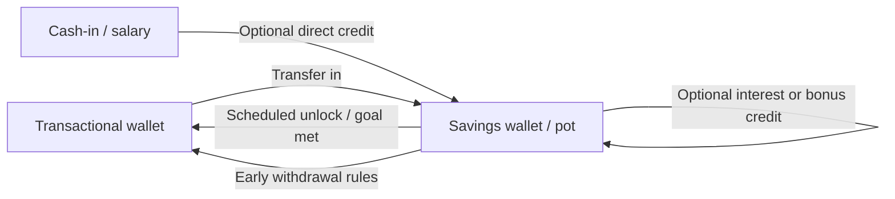

# Mobile Money Savings Wallets

An educational guide to **savings wallets** on a mobile money platform: goal-based pots, restricted spend, interest or bonus design (where allowed), and how savings sit beside the everyday transactional wallet and agent banking channel. Written for operators, fintechs, and product teams looking at platforms in the [EVD System](https://evdsystem.com/) and [MoboGage](https://evdsystem.com/about-mobogage/) family.

---

## What Is a Mobile Money Savings Wallet?

A **mobile money savings wallet** (also called a savings pot, goal wallet, or locked wallet) is a stored-value account that sits next to the customer's main wallet. Money moves in by transfer from the transactional balance, cash-in, or scheduled rules. Money moves out under stricter rules: unlock date, goal completion, or an explicit withdrawal that may carry friction or fees.

The product goal is behavioural: help customers set money aside without opening a separate bank account, while the operator keeps the funds on the same licensed e-money ledger and agent network.

### Typical use cases

- **Consumers** saving for school fees, festivals, or emergencies with visible goals
- **Families** using shared or child-linked pots with guardian controls
- **Agents** explaining savings as an upsell when customers cash in
- **Operators** reducing pure spend churn and deepening engagement on the mobile money platform

---

## How It Works

### Core components

| Component | Responsibility |
|-----------|----------------|
| **Pot / sub-wallet ledger** | Separate balance under the same customer KYC identity |
| **Goal engine** | Target amount, target date, progress display |
| **Transfer rules** | Who can move money in/out, limits, cooling-off |
| **Lock policy** | Soft lock (friction) vs hard lock (date-gated) |
| **Bonus / yield rules** | Optional credits where regulation allows; never invent yields |
| **Notifications** | Progress, unlock reminders, early-withdrawal warnings |
| **Agent UX** | Simple cash-in to pot and explanation scripts at the counter |

See [docs/savings-product-checklist.md](./docs/savings-product-checklist.md) for a product design checklist.

---

## Savings Models Compared

| Model | Customer sees | Ops notes |
|-------|---------------|-----------|
| **Open pot** | Free transfer in/out, labelled balance | Easy to build; weak behavioural lock |
| **Goal pot** | Target amount + progress bar | Strong UX; needs clear "edit goal" rules |
| **Time-locked** | Unlock date before free withdrawal | Best for commitment; early exit policy must be explicit |
| **Restricted spend** | Can pay only certain billers from the pot | Useful for school or utility goals |

Many platforms mix models: a goal pot that is soft-locked until the date, then free to move back to the main wallet.

---

## Design Considerations

- **One KYC, many pots.** Sub-wallets inherit the customer's tier limits; total exposure still counts toward AML and balance caps.
- **Ledger clarity.** Each pot is a real ledger account, not a UI filter on one balance — otherwise reconciliation and interest (if any) become messy.
- **Early withdrawal honesty.** If customers can break a lock, say what fee or lost bonus applies before they confirm.
- **Agent and USSD parity.** Savings features that only exist in the smartphone app exclude a large mobile money base; design USSD and agent flows early.
- **No fake yield.** Only describe interest, cashback, or bonuses that the licensed product actually offers.
- **Dormancy and escheat.** Define what happens to forgotten pots under local unclaimed-funds rules.
- **Separation from credit.** A savings pot is not a loan collateral product unless you deliberately design and license that link.

MoboGage's EVD System platform includes digital wallet and mobile money capabilities alongside voucher and top-up services, so savings-style sub-wallets can be designed on the same operational stack as cash-in, cash-out, and merchant payment when the operator productises them.

---

## FAQ

**What is a mobile money savings wallet?**
A dedicated or sub-wallet balance on a mobile money platform used to set money aside, often with goals, locks, or restricted spend, separate from day-to-day payments.

**How is it different from a bank savings account?**
It usually sits under the e-money / mobile money licence and agent network, with different deposit protection and product rules. Positioning must match local regulation.

**Can agents cash customers into a savings pot?**
Yes, if the product allows direct credit to the pot; otherwise the agent loads the main wallet and the customer transfers in.

**Should interest be advertised?**
Only when the scheme and licence support it. Educational materials should not invent rates or guarantees.

**How does this relate to MoboGage / EVD System?**
MoboGage provides wallet and mobile money capabilities within EVD System. See [mobile money platform with merchant payment](https://evdsystem.com/mobile-money-platform-with-merchant-payment/) and [about MoboGage](https://evdsystem.com/about-mobogage/).

---

## Glossary (short)

- **Transactional wallet** — everyday balance used for payments and transfers
- **Savings pot / sub-wallet** — labelled balance reserved for a goal or lock rule
- **Hard lock** — withdrawal blocked until a date or condition
- **Soft lock** — withdrawal allowed with friction, fee, or warning
- **Goal progress** — current balance versus target amount and date

---

## Further Reading / Related Industry Resources

- [Mobile money platform with merchant payment](https://evdsystem.com/mobile-money-platform-with-merchant-payment/) — wallet and mobile money product context
- [Wallet cash-in, cash-out, transfers and reversals](https://evdsystem.com/evd-software/wallet-cash-in-out-transfers-and-reversals/) — how MoboGage handles wallet money movement
- Related repo: [mobile-money-platform-overview](https://github.com/iwtglobal/mobile-money-platform-overview) — overview of mobile money platform building blocks

---

## License

Documentation in this repository is provided under the MIT License. See [LICENSE](./LICENSE).

*Educational material only. Not legal, regulatory, or financial advice. MoboGage and EVD System refer to offerings on evdsystem.com.*
